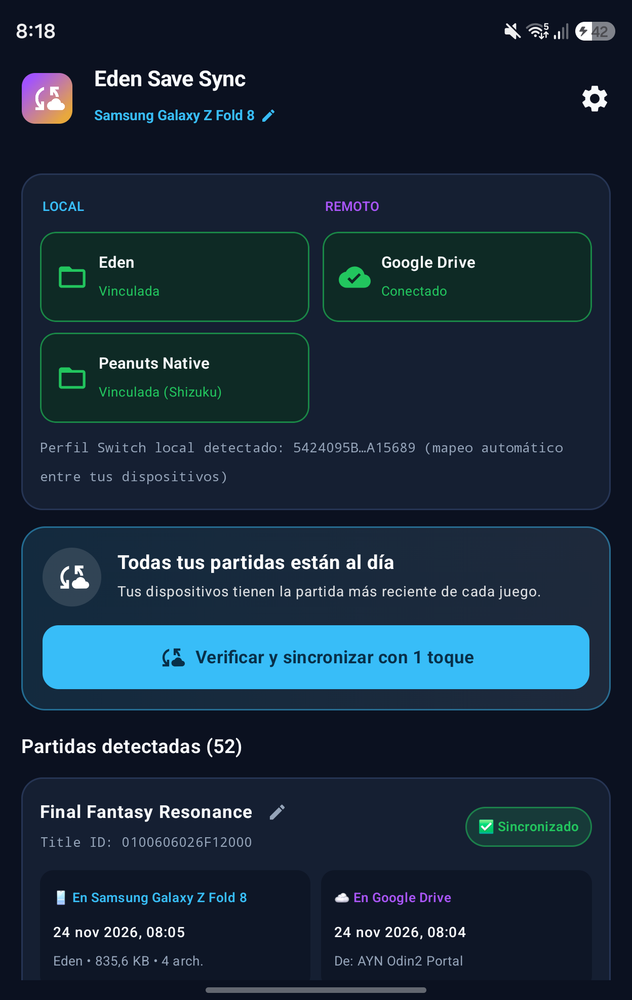
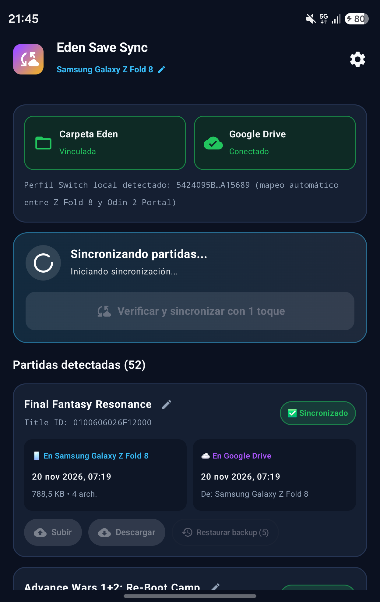
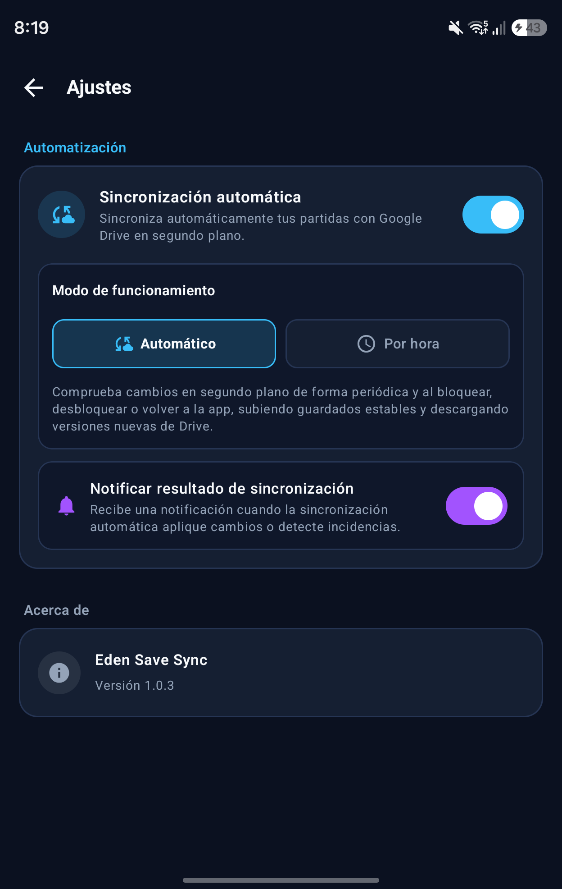

# Eden Save Sync 🔄🎮

**Sincroniza automáticamente tus partidas de Eden entre todos tus dispositivos Android usando tu propio Google Drive.**

Empieza una partida en tu teléfono, tablet o consola portátil Android y continúala exactamente donde la dejaste en otro dispositivo — **sin cables, sin PC, sin root y sin servidores externos**.

> Compatible con cualquier teléfono, plegable, tablet o consola portátil Android (con soporte completo para pantalla táctil y mando/gamepad).

---

## 📸 Capturas de pantalla

| Pantalla principal | Sincronización en 1 toque | Ajustes y automatización |
| :---: | :---: | :---: |
|  |  |  |

---

## 🚀 Cómo empezar (en 3 pasos)

### 1. Descarga e instala la app
1. Ve a la sección [**Releases**](https://github.com/jhuerta27/EdenSavesSync/releases) de este repositorio y descarga el último archivo `.apk`.
2. Ábrelo en tu dispositivo Android para instalarlo *(requiere Android 8.0 o superior y tener el emulador **Eden** instalado)*.

### 2. Vincula tu carpeta de partidas de Eden
1. Abre **Eden Save Sync** y toca en **«Carpeta Eden»**.
2. En el selector de archivos de Android:
   - **En Android 14, 15 o 16 (recomendado)**: abre el menú lateral (`☰`), elige **Eden**, entra en `nand → user → save` y pulsa **«Usar esta carpeta»**.
   - **En consolas Android o rutas personalizadas**: también puedes seleccionar directamente `Android/data/dev.eden.eden_emulator/files/nand/user/save`.

### 3. Conecta tu Google Drive y sincroniza
1. Toca en **«Google Drive»** y pulsa **«Iniciar sesión con Google»**.
2. Elige tu cuenta de Google en el navegador y acepta el permiso. Volverás automáticamente a la app.
3. Pulsa **«Sincronizar ahora»** para subir o descargar todas tus partidas en un solo toque.

Repite estos 3 pasos en tu otro dispositivo Android con la misma cuenta de Google y tus partidas quedarán siempre sincronizadas.

---

## ✨ Qué hace por ti

- **☁️ Tu nube, tus partidas**: Guarda tus partidas comprimidas en una carpeta llamada `EdenSaveSync` dentro de **tu propio Google Drive**.
- **🧠 Detecta automáticamente qué partida es más reciente**: Compara el contenido real (huella SHA-256) y la fecha de guardado para decirte qué conviene subir y qué conviene descargar.
- **🔀 Compatible aunque cada dispositivo tenga un perfil distinto**: Cada instalación de Eden crea un identificador de perfil diferente; la app los adapta automáticamente al sincronizar para que el emulador reconozca tus partidas sin hacer nada manual.
- **🛡️ Copias de seguridad automáticas antes de sobrescribir**: Antes de reemplazar una partida en tu dispositivo, guarda automáticamente un respaldo local (conserva los últimos 5 por juego) que puedes restaurar en 1 toque si lo necesitas.
- **⏰ Sincronización automática diaria**: Desde **Ajustes (⚙️)** puedes elegir una hora al día para que la app sincronice tus partidas en segundo plano y te envíe una notificación con el resultado.
- **🎮 Preparada para mando y pantalla táctil**: Navega cómodamente tanto con el dedo como con el D-pad / joysticks de tu consola portátil.
- **📋 Nombres de juegos automáticos**: Reconoce los títulos automáticamente y además te permite renombrar cualquier juego a tu gusto.

---

## 🔒 Privacidad y seguridad

- **Cada usuario usa su propia cuenta de Google Drive**: Nadie más tiene acceso a tus partidas ni hay ningún servidor intermedio.
- **Permiso mínimo (`drive.file`)**: La app solo puede ver y gestionar los archivos que ella misma crea dentro de la carpeta `EdenSaveSync`; no puede leer ni tocar ningún otro archivo de tu Google Drive.
- Consulta todos los detalles en nuestra [Política de Privacidad](PRIVACY.md).

---

## 🛠️ Catálogo de juegos

La app incluye un catálogo offline empaquetado en [`catalog/titles.json`](catalog/titles.json) y se actualiza automáticamente desde un Gist público para reconocer nuevos Title IDs sin tener que actualizar el APK.

## ⚠️ Aviso Legal

**Eden Save Sync** es una herramienta comunitaria de código abierto sin ninguna afiliación, patrocinio ni respaldo por parte de **Nintendo Co., Ltd.** ni del equipo de desarrollo del emulador **Eden**.

Este proyecto **no incluye, aloja ni distribuye ROMs, juegos, firmware ni claves criptográficas**. Su único propósito es facilitar la copia de seguridad y sincronización de archivos de partidas guardadas propiedad del usuario entre sus propios dispositivos.

---

## 📄 Licencia

Este proyecto se distribuye bajo la licencia **MIT**. Consulta el archivo [LICENSE](LICENSE) para más detalles.
